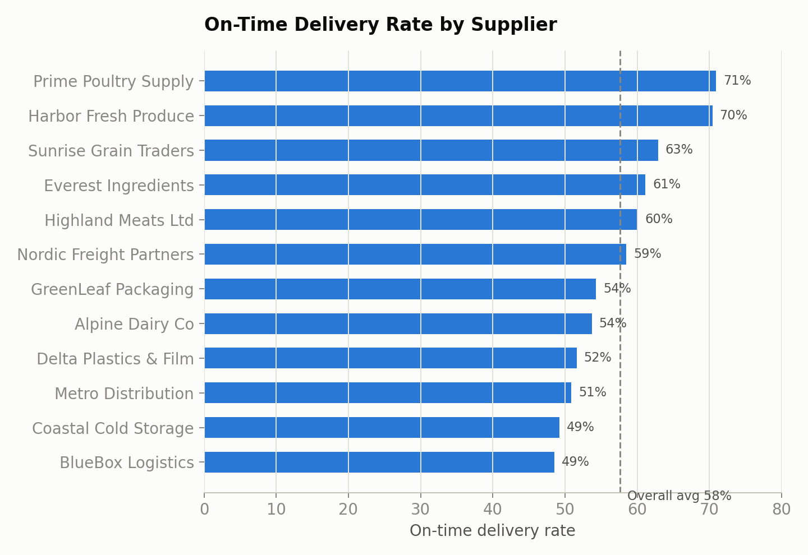
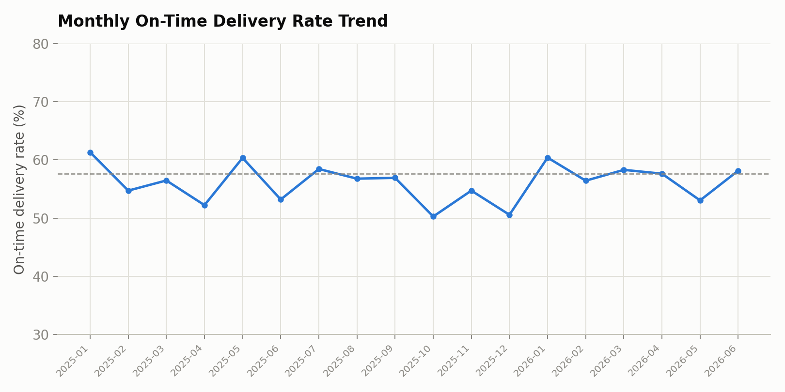
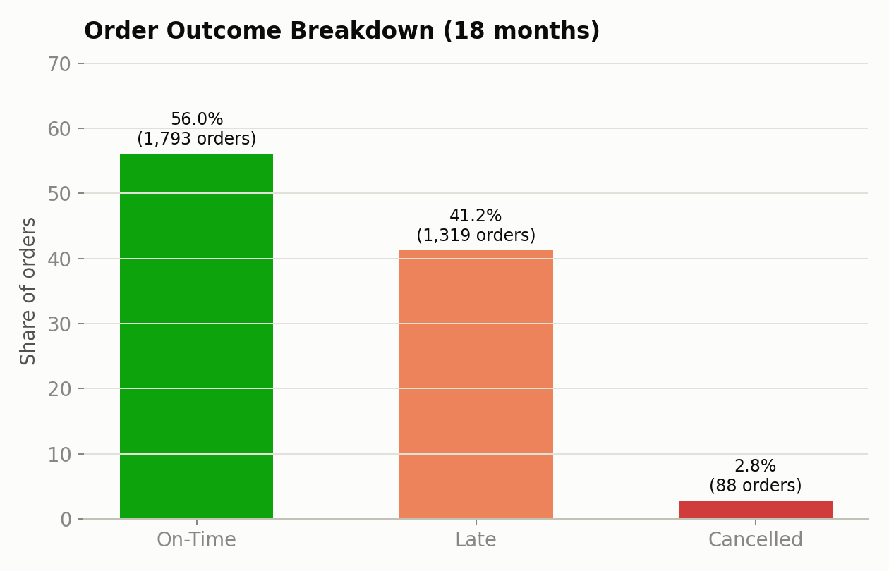
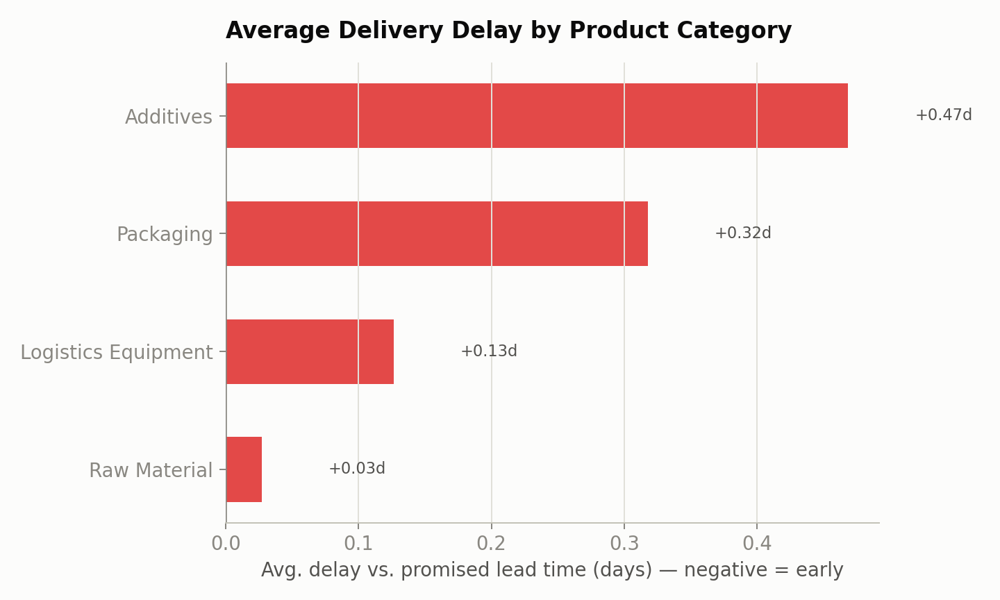

# Supply Chain Delivery Performance Analysis

A procurement analytics project. I clean purchase-order data, calculate on-time
delivery KPIs, and look at which suppliers, regions and product categories are
causing late deliveries and cost risk. Built with Python (Pandas, NumPy,
Matplotlib) and SQL (window functions, CTEs).

> Note on the data: it's synthetic. I generated it with a fixed seed
> (`01_generate_data.py`) and modeled it on a food-manufacturing supply chain, so
> I could build the whole pipeline (generate, clean, analyze, SQL, charts)
> without using any company's private data.

## Business question

Which suppliers and product categories are hurting on-time delivery and
spend, and where should procurement look first?

## Dataset

18 months of purchase orders (Jan 2025 to Jun 2026): 3,200 orders, 12 suppliers
across 5 regions (UAE, Saudi Arabia, Qatar, Kuwait, India), 8 products in 4
categories (Raw Material, Packaging, Additives, Logistics Equipment), delivered
to 5 regional warehouses.

| Table | Rows | Key fields |
|---|---|---|
| `orders` | 3,200 | order_date, supplier_id, product_id, quantity, unit_cost, promised/actual lead time, status |
| `suppliers` | 12 | supplier_name, region |
| `products` | 8 | product_name, category |

## Pipeline

| Step | Script | What it does |
|---|---|---|
| 1 | `01_generate_data.py` | Generates the synthetic order data (seed 42) |
| 2 | `02_clean_and_analyze.py` | Fills missing costs, calculates on-time/delay KPIs, groups by supplier/category/region/month |
| 3 | `03_visualize.py` | Makes the charts |
| 4 | `04_build_sql_db.py` | Loads the data into SQLite |
| 5 | `05_run_queries.py` | Runs the SQL queries and saves the output |

To run everything: `pip install -r requirements.txt && python 01_generate_data.py && python 02_clean_and_analyze.py && python 03_visualize.py && python 04_build_sql_db.py && python 05_run_queries.py`

## Key findings

- Overall on-time delivery rate is 57.6%, well under a typical 90%+ target. The
  average delay is only +0.17 days, so the problem looks concentrated in a few
  suppliers instead of being a general lead-time issue.
- 42% of total spend ($77M of $183M) is in late orders. That's higher than the
  41% late-order rate because some high-value products (grain/cereal base, cold
  chain pallets) lean toward the worse suppliers.
- The four worst suppliers sit around 49-52% on-time, roughly 9-20 points below the
  58% average. BlueBox Logistics (Kuwait, 48.6%) and Coastal Cold Storage
  (India, 49.3%) are the lowest. Both are logistics/cold-chain providers rather
  than raw material suppliers, so it may be a transport/handling issue.
- Additives and Packaging run +0.47 and +0.32 days over promised lead time, about
  4-5x the gap for Raw Materials (+0.03 days). Those two categories are where
  lead-time commitments should be renegotiated.
- Monthly on-time rate bounces between 50% and 61% with no clear seasonal
  pattern, which suggests supplier management rather than demand planning.

## Charts

| | |
|---|---|
|  |  |
|  |  |

## SQL

`sql/supply_chain_queries.sql` has 5 queries using joins, `GROUP BY`, `CASE`,
a CTE, and window functions (`RANK() OVER (PARTITION BY ...)` for the worst
supplier per region, and `AVG() OVER (... ROWS BETWEEN 2 PRECEDING AND CURRENT
ROW)` for a 3-month moving average). `05_run_queries.py` runs them, and the full
output is in `sql/query_results.txt`.

## Recommendation

Start with a performance review of BlueBox Logistics and Coastal Cold Storage
(both more than 9 points under the network average, both logistics/cold-chain),
and renegotiate lead-time terms for Additives and Packaging, which have the
biggest gap between promised and actual.

## Tech stack

Python 3, Pandas, NumPy, Matplotlib, SQLite3 (standard SQL, should port to MySQL 8+ / PostgreSQL)

## Author

Ahsanullah Khalid - [LinkedIn](https://www.linkedin.com/in/ahsanullah-khalid)
